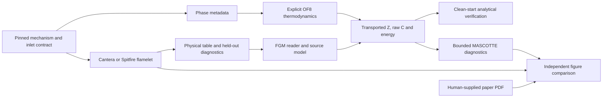
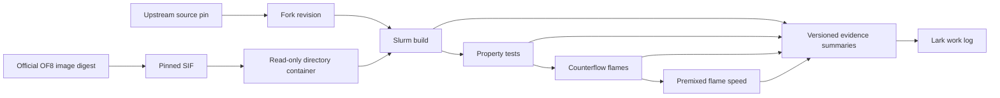

# Replication boundaries

The developed solver enters Z transport only for a tabulated composition model.
Direct-species/none models do not construct Z and keep the ordinary species path.
The Schmitt contact tests consume this path; the tabulated FGM equation order is
unchanged. Its local solver README owns the runtime and verification contract.

`validation/schmitt-contact` prepares the nonreacting real-fluid contact tests
from Schmitt2020 Figures5/6. It consumes the thermo export and shared finite-volume
schemes. Its initializer inverts density through the actual linked thermo model;
it does not implement or tune an alternative equation of state. Batch admission,
run identities and comparison interpretation remain operator responsibilities.

`validation/mascotte-g2/log-stream` provides bounded streaming access to complete
retained solver logs and incremental JSON output. `direct-fgm/check.mjs` and
separately versioned operator endpoint/density/projection/conservation adapters
consume it while retaining their scientific parsers and criteria. It preserves
full raw-file identities and original line mappings and does not depend on or
modify the solver, case generator, scheduler or remote environment.

The optional SRK unused-diffusion setup path depends on the shared basic-thermo
policy and Chung transport's explicitly diffusion-free update. It preserves
EOS/Chung calculations and corrected X/Y, and adds no cache or object layout.
Only immutable hePsiThermo, absolute-Ha, laminar/Fourier fgmTable or
steadyFlamelet cases may select it. Both thermophysical registration libraries
and the diagnostic probe must be rebuilt; source-only or solver-only replacement
does not qualify this template change. Physical property and fresh CFD parity
remain required before adopting the candidate.

`combustionModels/steadyFlamelet` is a separate fixed-dissipation, delta-PDF
composition closure for a retained physical burning flamelet. It consumes a
strict one-dimensional Z table and the full thermo species set; it does not
depend on the FGM reader or progress-source integrator. `reactingFoamSolveZ`
refreshes its composition after Z transport and before absolute-Ha transport.
The real-fluid thermo library retains density and temperature ownership.
Its case preparation reuses only mesh, observation and thermodynamic input
utilities; physical exports and run qualification remain explicit inputs.

`fgm/isenthalpic-witness` consumes the two exact physical mixing initial states
and their primary source receipts, gives both the same specific enthalpy and
pressure without changing their species compositions, and runs fresh full
chemistry. It depends only on the pinned Cantera runtime and existing
hybrid-water state/reactor utilities. It neither modifies table coverage nor
changes CFD or scheduler behavior.

The [direct FGM development checkpoint](../development/direct-fgm/README.md)
combines selected source snapshots on the existing reacting integration baseline.
It is a candidate development branch, not a scientific acceptance or a change to
the source identity of a running job.

`fgm/direct-flamelet` generates independent Cantera counterflow solutions,
equilibrium limits and physical-time Sandia Spitfire flamelets. It exports phase
metadata and builds a physical raw-progress table with held-out diagnostics.
Its dependencies are explicit Python scientific packages and a pinned Spitfire
extension; it does not depend on OpenFOAM or perform scheduler operations.
`fgm/progress-reactor` independently follows full Cantera/CVODE chemistry from
hash-bound table T/Y states at constant pressure/enthalpy. It diagnoses coverage
and progress-coordinate reversal using accepted and requested-time observations,
without modifying the table or depending on the CFD runtime or Spitfire.
Its separate Matplotlib renderer consumes hash-bound collected traces; plotting
adds no dependency to the reactor integration path.
`src/combustionModels/fgmTable` consumes the declared table and supplies species
and volumetric sources. `applications/solvers/reactingFoamSolveZ` transports Z
and raw progress, and offers an opt-in absolute-enthalpy equation. Thermodynamic
and transport models remain explicit solver dependencies; the table does not
silently replace their density or temperature calculation.

`validation/fgm-of8/direct-verification` generates fresh finite-volume heating,
scalar-advection and chemical-energy conversion problems and measures their
analytical errors. It also converts complete NASA7 phase metadata for a later
physical table case. `validation/muller-figure2` and `validation/mascotte-figures`
extract and compare selected paper curves from separately supplied PDFs. These
offline evaluators do not submit jobs or supply fitted model coefficients.
The small `.tbl` fixtures qualify reader arithmetic only; they are not flamelets.

`validation/mascotte-g2/coarse-wedge` creates a fixed co-planar blockMesh recipe
and qualifies actual generated ASCII mesh bytes and mesh-tool receipts. It
depends only on Node built-ins and, for execution, OF8 blockMesh/checkMesh through
an admitted allocation. `direct-fgm/prepare.mjs` consumes the resulting asset
only with an explicit coarse mesh mode. The canonical mesh loader and identity
remain unchanged; the coarse diagnostic has no dependency on canonical mesh
bytes and does not constitute paper geometry or mesh-convergence qualification.

`development/liang-kinetics` consumes explicitly identified author mechanisms
and the pinned Cantera 3.2 SDK for Figure 8(b)'s ideal methane controls. It has
no SRK or OpenFOAM dependency in this initial stage. Input hashes and the
fixed-100-atm HP contract qualify the mechanism representation separately from
the flame solve; output profiles feed the paper comparison gallery.
An optional named-species steady-profile guess is an explicit data input; the
kinetics driver maps it by species name and records discarded guess mass.
It is independent of transient CFD restarts and does not supply boundary data.
An optional author binary-polynomial table modifies only the ideal driver's
mixture-averaged mass diffusion. It uses the Cantera SDK directly, without a
dependency on hydrogen-specific or SRK adapters, and records its own input hash.
Its offline Figure 8(b) renderer depends on PyMuPDF, collected result snapshots
and independently digitized paper calibration. The optional earlier GRI summary
is an explicit data input; it does not introduce a runtime solver dependency.
Its offline carbon-count subset preparer uses Cantera Python, NumPy and ruamel.yaml to
preserve and verify retained rates. The output is a labelled structural
sensitivity input, not an inferred author mechanism or a production dependency.

`development/liang-hydrogen` consumes the author Burke 2012 mechanism and
qualified species parameters, reusing `cantera-liang` SRK, transport,
pressure-chemistry and total-enthalpy adapters. It supplies Figures 3–7 with
steady hydrogen flame and transport profiles; Figure 2 remains the independent
`liang-properties` critical audit. Downloaded mechanism files stay outside Git.
Its bounded Slurm jobs have no production CFD or transient-restart dependency.
Its optional thermal-diffusion controls consume a separate author collision
sidecar from the same transport source as its binary coefficients. A protected
collision-ratio hook extends only the existing manual-Soret coefficient.
The shared native-flow wrapper supplies thermal and enthalpy fluxes and records
face diagnostics. No-Soret inputs have no dependency on that sidecar.
Its offline thermal-diffusion comparison reuses the native-face audit from
`cantera-liang/analyze_soret.py` and the local hydrogen digitizer/profile checks.
This analysis dependency does not change either runtime model.
Its conservative numerical control aliases `cantera-liang/ConservativeFlow`,
which applies the same face-advection/divergence construction to species
and total enthalpy. Both methane and hydrogen consume this shared class
and its manufactured residual fixture; the shared module does not depend
on the hydrogen driver.
Stock boundary equations and property/chemistry adapters remain dependencies;
the control neither patches Cantera nor changes production CFD.
Its offline conservation audit consumes native node/face CSVs, uses Cantera
Python only for species/element metadata, and shares a NumPy-only profile
reader. Figure extraction is not a dependency of that numerical audit.
Its read-only collector retrieves selected small job artifacts. The independent
NumPy/PyMuPDF renderer overlays those profiles on the locally supplied paper
panels and exports PNG/PDF evidence; it never changes models or submits jobs.
The energy diagnostics reuse the previously qualified SRK C4 alpha continuation
and can explicitly subdivide every initial-grid interval for convergence checks.
The hash-pinned vector digitizer consumes only the local paper, independently
of simulation results, and supplies reading uncertainties to comparison screens.
The comparison screen consumes its reference JSON and completed profile snapshots;
it preserves separate transport variants and reports numerical conservation.
The Figure 7 structure comparator consumes the same pinned PDF, its independent
calibration and explicitly selected profiles. It supplies spatial/profile metrics
without a new model, alignment scale factor or acceptance decision.
Its structure renderer consumes the comparator's hashed aligned-data export
and explicit job selection, retaining the paper geometry and each run's identity.
The all-species diffusion replay additionally depends on Cantera Python 3.2 and
`validation/diffusion`'s independent table, with parity against frozen C++ output.

`validation/diffusion` consumes committed Liang flame comparisons, primary-source
diffusion fixtures, author mechanism inputs and the pinned Cantera 3.2 SDK. Its
prescribed-state C++ probe uses the actual `cantera-liang/StagedTransport.h`;
independent Python calculations verify its correlation and compare dilute
transport with measurements. It supplies the Case 5 investigation with property
gates, without changing model parameters or solving flames. Production solvers
have no dependency on this module. Its optional NumPy/Matplotlib renderer consumes
the gate artifacts and supplies a property-comparison PNG/PDF to the report.
The extended property renderer also uses PyMuPDF to preserve the earlier PDF
page while adding light-species and high-pressure self-diffusion comparisons.
These measured and evaluated-reference checks change no flame-model inputs.

The `liang-properties` conductivity diagnostic consumes a Cantera ideal phase,
an explicit species table and optional frozen flame profiles. Its independent
NumPy SRK/mapping equations qualify baseline parity and prescribed-volume
mapping alternatives without changing the compiled flame transport adapter.
Its measurement probe consumes an explicit local JSON fixture and the same
kernel, retaining unqualified composition interpretations separately. It supplies
only offline property evidence; no flame input or model depends on its scores.
Its cold-oxygen Cp probe consumes the native property CSV, original species
dictionary and paper-reading CSV. It uses the same independent mathematics
to isolate a published Shomate-Cp substitution. It supplies only diagnostic
evidence; no solver or production thermodynamic model consumes its output.

`development/cantera-wave` consumes a screened ideal Cantera profile and the
`fresh-start` case generator. Its Python generator produces mirrored original-zero
fields without a Cantera runtime. The native runner depends on
`temperature-inversion`, a qualified library, OF8 and Slurm. Its optional
Cantera transport mode adds the existing `cantera-cfd` instrumenter/configurator
and qualified `cantera-bridge` runtime. Default native execution has no Cantera
runtime dependency. It does not supply a transient restart.

`development/temperature-inversion` consumes an isolated full native library
build and generates original-zero ideal flames through `fresh-start`.
It uses `flame-tracking`, `premixed-paper`, the `cantera-cfd` static partitioner
and the adaptive field reader. Its solver has no Cantera runtime dependency.
Explicit CPU assignments and global-field parity qualify 32-rank execution.
Its front and heat-release histories feed the comparison gallery.

`validation/profiling/affinity.py` reads the current Slurm allocation's solver
processes and can assign distinct CPUs inside their existing affinity union.
It depends on Linux/Python process APIs only and changes no solver source, field,
time history or scheduler allocation. Its JSON receipts feed performance reports.

`development/cantera-cfd` depends on `cantera-bridge`, `flame-tracking` and
`fresh-start`. It builds an isolated ideal-gas transport experiment using
Cantera conductivity/diffusion and refreshed native species enthalpies.
It consumes original-zero inputs; it does not replace production thermodynamics
or chemistry. Its bridge binary must pass separate ABI/property qualification.
Its optional `bands32` execution profile uses the shared adaptive field reader
to check the original slab, then writes a manual cell-to-rank assignment.
`fresh-start` verifies all 32 declared zero-time partitions. No model coefficients
or physical mesh are changed by this execution profile.

`development/cantera-bridge` depends on the pinned Cantera3.2 SDK and
`development/cantera-liang` adapters. It exposes state properties and net sources
through a C ABI, with no Cantera/OpenFOAM C++ objects crossing the boundary.
Its independent ABI client consumes saved FreeFlame profiles for parity checks.
No production CFD solver depends on this draft yet.

`development/cantera-bridge` also exposes an experimental closed constant-pressure
chemistry step through Cantera ReactorNet/CVODES. It depends on the same SDK and
model adapters. Frozen Python reactor references qualify the ideal closure before
coupling. `cantera-cfd` has a separately configured adiabatic-CP experiment that
converts integrated mass-fraction changes into species and sensible-energy
sources. Transport-only mode remains the default; no nonideal CFD is enabled.

`development/cantera-liang` registers SRK thermo and staged transport with the
pinned Cantera C++ SDK. It consumes ideal-baseline mechanisms/profiles and the
liang-properties Ely–Hanley kernel. Its independent steady flames feed the
Liang comparison report; production OpenFOAM code has no dependency on it.
Its optional light-species Soret control uses an internal algebraic kernel and
the same SDK transport data. Its offline Soret analyzer consumes hashed
profiles and native face fluxes with NumPy. Neither path introduces a
production CFD dependency or changes the no-Soret baseline.
Its offline element-balance check additionally uses Cantera Python's pinned
mechanism stoichiometry. It reports endpoint element changes and reconstructed
conservative face fluxes from the same hashed snapshots, without a flame solve.
Its native conservation audit consumes the shared conservative-flow exports
and the observed methane job records. It shares elemental metadata with
`element_balance.py`; it has no dependency on hydrogen-specific configuration.

`development/fresh-start` consumes ideal-baseline initial-state generation,
premixed-paper boundary finalization and flame-tracking anchors/checks. It reuses
qualified native/energy binaries with unchanged libraries and supplies time-0
histories to solver-comparison. It has no dependency on donor checkpoints.

`development/solver-comparison/sampleHistory.C` consumes frozen stock/DeepFlame
line profiles through the shared `flame-tracking/trackingCore.H`. Its CSVs and
native in-situ tracking CSVs feed `plot_history.py` (NumPy/Matplotlib), which owns
offline time-history PNG/PDF/CSV exports and provenance for the Lark comparison.
This analysis path has no scheduler or solver mutation dependency.

`development/flame-tracking` uses the premixed-paper generator, ideal-baseline
donors and saved Cantera anchors to add read-only runtime OH/temperature tracking.
It reuses the environment runner and adaptive field reader for isolated build,
qualification and continuations. The species-solve source remains a separate
measure. It does not depend on Cantera at CFD runtime or alter the library.

`development/premixed-sensitivity` consumes the qualified spatial diagnostic
executable and identical products checkpoints. The validation runner dispatches
three isolated fixed-step segments. It supplies time-step and restart comparisons
to analysis without changing solver source or the active donor. The module keeps
temporal, marker, and source-stage agreement as separate acceptance checks.
Its saved-field qualification reuses the adaptive field reader for finite fields,
species normalization and heat release. Completion checks distinguish the solver
endpoint from inherited checkpoint output phases.

`development/premixed-paper` depends on the named baseline solver, flame input
generator, property probe, field reader and contained environment. It creates
central-ignition two-front cases and an isolated diagnostic solver, then supplies
stage-labelled in-situ Eq.(40) histories to plotting. It changes no library
physics. The instrumented solver must match diagnostics-off fields before use.
Its optional central products initialization consumes a versioned ideal-gas HP
seed from the earlier premixed-inlet module, with the original generator commit
and NASA7 hash recorded. This is a data dependency; Cantera is not required in
the solver runtime. Both initialization variants use the same diagnostic runner.
`development/heat-release` loads a read-only observer into these running solvers.
It depends on the qualified chemistry ABI and OF8 function-object interface,
and supplies signed source histories and fields to comparison analysis. Its
on/off replay must pass before any live controlDict attachment.
The premixed draft solver now owns a registered `Qdot` energy-source field;
heat-release qualification depends on its generator and compares the new binary
against the previous executable plus the qualified observer. Existing running
jobs retain their executable and load only the observer.
`development/premixed-spatial` depends on the premixed generator, qualified native
solver/library and immutable donor checkpoints. Its isolated replay exports local
source/diffusion/gradient fields to spatial analysis; it never replaces a live
binary. Paper-Fick and deployed corrected diffusion remain distinct outputs.

`development/ideal-baseline` depends on the premixed-paper setup, the qualified
spatial diagnostic binary, the ideal runtime library family and environment
runner. Its separate Cantera adapter reads author NASA7/reaction inputs and
supplies equilibrium seeds and independent steady flame profiles. Cantera is
not a CFD runtime dependency. Comparison plotting consumes both result sets
and a locally held Liang figure crop; it does not submit work.
Its running-case assessment reuses the premixed-sensitivity CSV reader and
kinematic tracking routines on local snapshots. It reports diagnostic gaps
without changing running jobs or promoting transient speeds to accepted data.

`development/liang-properties` consumes the qualified SRK library and author
species data for density/critical-point probes, and owns an independent
Ely–Hanley conductivity kernel. It supplies property CSV and original-scale
Liang Figure 1/2 comparisons. It has no Cantera flame dependency and does not
change production solver physics. Staged reacting closures depend on these
property checks before promotion.
Its offline critical audit uses NumPy for independent pressure-derivative solves
and PyMuPDF for calibrated source-curve extraction. It reads the native probe CSV
and species dictionary; it never supplies fitted coefficients to a reacting run.

`environment/` owns recipes, the image lock, contained execution, and job submission.
`development/liang-panel-a` consumes the ideal-baseline Cantera profiles and
local Liang PDF. It adds ideal-gas operating points and preserves the source
panel's size and graphics in a calibrated overlay. Cases 2–5 remain paper
references. This module has no solver, scheduler or real-gas Cantera dependency.
`docs/` owns the scientific plan, writing rules, and reviewed result summaries.
The offline `validation/figures/liang_atlas.py` assembler consumes explicit
property, hydrogen, Figure 8(a) and mechanism comparison PDF pages and evidence
files, with optional explicitly selected structure-control appendix pages.
It preserves page dimensions and hashes inputs; it neither reruns models
nor changes scientific acceptance.
`development/` owns the single `develop/reacting` integration line and isolated
draft experiments. Its named solver depends on the pinned OF8/library build;
benchmark runners depend on that solver or the unchanged upstream executable.
`validation/` owns case generation, property probes, and scientific comparisons;
it uses contained execution from `environment/` and a completed isolated build.
`validation/properties` owns library probes and NIST comparisons; its optional
plotting step uses a separate local matplotlib environment. `validation/flames`
uses the same property probe for inlet densities before setting velocity constraints.
`validation/figures` consumes the property and pilot artifacts plus supplied PDFs
to create a local figure atlas. It uses PyMuPDF/reportlab for extraction/reporting
and the same matplotlib environment for scientific plots; it submits no jobs.
Future case modules own their inputs, reference data provenance, comparisons, and README.

`validation/profiling` depends on a qualified build and stopped flame checkpoints.
It uses the environment runner to build a separately named, timer-instrumented
solver and replay copies of cases. It produces per-rank section timings; production
solver binaries, source builds and original case directories remain unchanged.

`validation/flames/author-counterflow` owns the original OF6 tutorial input port
to the qualified OF8 solver, including one-step-to-GRI30 field transfer. It uses
the environment runner and shared counterflow budget ledger. Its inputs supersede
the reconstructed campaign for the owner-selected baseline as of 2026-10-17.
The solver remains upstream code unless a separate source change is recorded.

`validation/flames/adaptive` copies stopped decomposed flame checkpoints and changes
time/output controls for bounded adaptive continuations. It depends on the qualified
build and environment runner, and provides hashes, smoke checks and field-change
diagnostics to later figure/convergence assessment. It does not modify solver physics.

`validation/flames/paper-campaign` extends that author-input port to the remaining
counterflow conditions and uses the existing premixed generator for the 11-point
Figure 12 sweep and selected sensitivity cases. It depends on the author transfer,
flame field checks, property probe and environment runner, and shares the bounded
reservation ledger. DeepFlame is inspected as a case reference, not a dependency.

The project workspace owns `images`, `releases`, `builds`, `jobs`, `logs`, `cache`,
`tmp`, `home`, and `results`. Each job has its own temporary and home directories.
Source releases are immutable inputs. Compilation uses a separate build copy.
An image hash identifies bytes; a preflight establishes site compatibility.

The flame module's `campaign.py` validates explicit development configurations;
`submit_campaign.sh` reserves worst-case allocated core-hours in a project-local
ledger before submission. The existing validation runner handles decomposition,
contained single-node MPI, reconstruction and final field checks. It does not
infer convergence from a successful run. Figure rendering consumes reconstructed
case fields through an explicit case manifest, separately from job submission.

`development/solver-comparison` consumes ideal-baseline seeds and Cantera profiles
for isolated stock OF8 and DeepFlame OF7 runs and native chemistry probes. It owns
its contained build/job wrappers and read-only sampling. Its outputs feed the
flame diagnosis; it does not replace the production solver or its live cases.
Its offline profile adapter depends on `development/flame-tracking/trackingCore.H`
for the same marker and gas-relative speed definitions. Its read-only source audit
compares the Linux build copy with the pinned Git archive, including path casing.

`development/cantera-liang` owns staged steady-flame diagnostics against Liang.
It depends on the pinned Cantera SDK, `ideal-baseline` inputs and the shared
`liang-properties` conductivity kernel. Its optional pressure-chemistry source
adapter owns a separate ideal Cantera phase; the SRK flow phase remains separate.
Frozen-state and energy-flux probes qualify these diagnostic options before
figure comparisons. Production OpenFOAM solvers do not depend on this module.

`validation/realfluid-g2-thermo` combines the exact phase metadata from
`fgm/direct-flamelet` with identified Nguyen tutorial critical and transport
parameters. It prepares inputs for the full SRK/PR library stack and records
optional NASA extrapolation bounds. It neither executes CFD nor qualifies
the resulting real-fluid properties. The full-fork G2 case is its dependent;
stock-OF8 combustion-only diagnostics cannot qualify this interface.

`validation/mascotte-g2/direct-fgm` consumes the registered binary wedge mesh,
the physical v2 table and phase metadata to generate new zero-time fields. Its
batch wrapper depends on the direct finite-volume checks and a qualified OF8
environment; it records MPI consistency before a bounded warm G2 diagnostic.
It neither owns scheduler admission nor qualifies cold real-fluid physics.
`validation/realfluid-g2-thermo/probe` consumes the exporter dictionaries and
the full fork libraries, separating thermophysical evaluation from CFD.

`validation/flamelet-review` consumes hashed physical trajectories, held-out
table diagnostics and explicitly calibrated original paper crops. It produces
local HTML and figures, preserving failed diagnostics and condition differences.
It has no runtime chemistry, scheduler or scientific approval dependency.
The flamelet module's optional upstream patch is independently identified by
original/patched source hashes; its energy and progress audits do not modify
the physical data they inspect.

`validation/g2-review` consumes explicit sampled CSV fields from the G2 generator
and the identified Sharma Figure 4b reference. It separates instantaneous and
time-mean profiles, retains missing image points, original captions and unresolved
axial alignment, and labels OH mass fraction separately from optical OH*.
It depends on the observation contract and reference extraction, not the solver
runtime, scheduler or publication service.

`validation/g2-paper-review` composes that named-sample reader and axial plotter
with `mascotte-review`'s identified reference assets. It renders preliminary
Cavalieri station profiles and instantaneous T/rho/OH maps without fabricating
statistics. Optional `oh-lte-proxy` postprocessing consumes co-located actual
instantaneous T/rho/OH and phase metadata; it computes the 308 nm LTE population
approximation before any declared time averaging. Neither module performs LOS
integration, radiative calibration, solver execution, acceptance or publication.

`fgm/ignition-family` owns the fresh compact product-seed experiment at conserved
mixed-stream enthalpy. It reuses `direct-flamelet` input/runtime identities and
physical export helpers, plus the already qualified Cantera/Spitfire runtime.
Its checkpoints and dual-progress diagnostics describe actual trajectories;
they do not modify the CFD table, submit jobs, or grant scientific acceptance.
Its optional offline plot consumer uses NumPy/Matplotlib and retained raw/hash
receipts; it has no dependency on the scheduler, solver or publication service.

The G2 generator's optional cold mode also consumes the exact real-fluid export
and the qualified full-fork library receipt. Its initializer computes time-zero
Ha with that runtime, including backflow reference values. Cold batch execution
reuses those libraries read-only and builds only the identified solver/probe.
Source-off and reacting cases retain separate time controls and result identities.

`validation/pr-cpmcv` checks the PengRobinson heat-capacity identity against
independent finite-difference pressure derivatives. It reads the actual header
expression, preserves the historical failing expression as a negative control,
and does not substitute algebraic checks for compiled property/inversion sweeps.

`validation/fgm-of8/direct-verification/schemes.mjs` owns the explicit finite-volume
operators selected by the verification and G2 generators. Its consumers retain
their separate physical inputs and acceptance rules. The G2 initializer can
decompose fresh fields, evaluate full-runtime Ha on each rank, and reconstruct
time zero after a small serial/parallel parity qualification.

`fgm/direct-flamelet/source_ode.py` and its C++ counterpart integrate the actual
table's piecewise-linear source at fixed Z and density. They report outward
coverage events rather than altering table endpoints. The Python 1D splitting
experiment is a source/transport prototype; it does not change the OF8 solver.
`validation/muller-figure2/paper_compare.py` consumes exact-source continuation
receipts to render Figure 2/3, preserving unconverged states and extinct points.

`validation/mascotte-review` prepares pinned Cavalieri, Schmitt, Singla and Sharma
targets for the existing catalogue. It extracts Cavalieri Figure 6 vector data,
retains original captions, and records numerical versus optical comparison
contracts. CFD refresh requires source, mesh, origin and sampling identities;
instantaneous results cannot populate invented RMS or statistical acceptance.

`validation/mascotte-g2/paper-exit-wedge` owns a distinct 10k-cell recipe with
paper-sized O2/methane exit areas and x=0 at the co-planar exit. It reuses only
the narrow ASCII parser from `coarse-wedge`, preserving that module's immutable
recipe/asset meaning. `direct-fgm` selects its separately qualified loader
explicitly. Upstream taper, chamber corners and turbulence remain outside this
partial geometry diagnostic; source and physical acceptance are unchanged.

`combustionModels/fgmTable` optionally uses the standard-C++ fixed-state source
kernel copied from direct-flamelet commit `c67dfe2910dc2275270d3dccc2a5f3fedb75862a`.
The reader owns conversion from its v2 table to fixed-Z source curves. The model
applies those curves to explicit stage inputs. `reactingFoamSolveZ` owns time
splitting and unchanged oldTime storage; thermodynamics retains energy and density.
`validation/fgm-source-split` supplies the allocated source-stage probe and
actual-table 0D/1D qualification plan. No runtime dependency on Python, Spitfire
or the flamelet generator is introduced into the CFD solver.
Its offline `reference.py` independently integrates the uniform fixed-density
table-source ODE with SciPy DOP853 and compares retained CFD time histories;
this analysis dependency never enters the production solver.

`validation/mascotte-g2/direct-fgm` prepares fresh warm diagnostic cases on the
registered wedge. It consumes hashed physical tables/NASA metadata through
`validation/fgm-of8/direct-verification`, plus a separately registered mesh.
Its observation/decomposition module emits OF8 sampling and averaging settings;
its read-only diagnostics consume actual fields, boundary phi, averaging
counters and solver clock records. These modules do not submit work or grant
scientific acceptance. The configurable single-node batch wrapper depends on the
qualified stock OF8 environment and a pinned custom combustion library.
Full real-fluid preparation separately depends on the complete fork runtime
and `validation/realfluid-g2-thermo/probe`; changing an input dictionary alone
does not qualify the runtime or cold-table coupling.
Its opt-in cold initializer consumes the complete full-build product receipt,
checks actual solver/probe dynamic bindings, and uses that probe to initialize
time-zero Ha. The probe writes the matching thermoType marker consumed only by
guarded cold solver cases. It does not submit jobs or grant physical approval.
# Caloric qualification

`validation/fgm-of8/direct-verification/thermo-policy.mjs` owns explicit NASA
inversion-range declarations and per-species original/effective records.
Source-stage preparation consumes that policy. The solver owns the opt-in
executing-thermo closure audit; evaluators require its records and reject
range-clamped false convergence. Neither module changes NASA coefficients.
The solver separately reports post-pressure caloric drift; evaluators retain it
without treating the inversion limit as a coupled-convergence criterion.
G2 sampling supplies co-located instantaneous T/rho/OH to independent optical
postprocessing, keeping ordinary OH and excited OH diagnostics distinct.
`validation/realfluid-g2-thermo/diffusion-performance` prepares paired full-SRK
property/inversion cases from the exact physical table. It depends on that
module's runtime probe and `fgm-of8/direct-verification/physical-input.mjs`.
The full-fork hePsiThermo opt-in suppresses unused species diffusivity evaluation
only after explicit FGM/Fourier/absolute-enthalpy checks; public Dimix reads fail
while suppressed. The class layout and default full calculation remain intact.
This module records numerical parity and timings, not scientific acceptance;
subsequent identical fresh CFD comparisons qualify actual solver use.

`validation/mascotte-g2/conservation` is an offline Node auditor of retained
energyState/energyEquation records and boundary phi histories. It uses exact
printed step identities to separate final-state coupling drift from assembled
residuals; it neither changes a solver nor chooses acceptance thresholds.

`validation/oh-lte-proxy` consumes co-located instantaneous T/rho/OH and the exact
phase molecular weight to calculate the paper's 308 nm LTE population proxy.
It transforms before averaging and does not infer LOS intensity or optical
calibration. Both modules depend only on Node standard libraries and explicit
input files; future review renderers consume their separate retained outputs.

The solver's optional `fgmTiming.H` depends only on OF8 communication containers
and the C++ steady clock. It measures local inclusive regions and gathers rank
counters only at existing writes/end; it does not alter the scientific models
or require a scheduler/runtime service. Operator performance analysis consumes
its logs separately from conservation and physical acceptance.

`validation/realfluid-g2-thermo/diffusion-setup` qualifies the narrower omission
of SRK diffusion-matrix construction and copying. It consumes the physical
six-state probes and both tabulated-composition periodic cases. Its concrete
mixture audit calls the real cell/patch implementation and raw Dimix guard;
it owns no duplicated property formulas. Rebuilt registrations and exact
retained-product identities belong to the allocated build receipt.

`fgm/hybrid-water` performs a bounded, allocated physical-tail experiment using
retained quench states and fresh Cantera constant-pressure reactors. It depends
on pinned Python/NumPy/Cantera and exact direct-flamelet artifacts. Its separate
water-progress v2 table is a potential input to the existing OF8 table reader;
no runtime dependency on the generator enters CFD. It records branch omissions,
source bounds and independent-Z errors, and cannot replace a table or grant
scientific acceptance automatically. Its separate `derive.py` reuses exact
retained branches without integration, preserving the physical source/job while
recording any explicitly selected, already bounded endpoint representation.
Its `extend.py` selectively performs fresh longer chemical trajectories for
observed positive source caps, preserving unaffected physical branch identities
and recording a tighter-step physical spot comparison before table reuse.

`validation/hybrid-water-review` reads immutable `fgm/hybrid-water` results and
produces offline figures/HTML with input hashes. It has no physics, scheduler or
publication side effects. Source bounds, independent-Z errors and energy-source
projection remain separate diagnostics; the renderer never accepts the table.

`fgm/mixing-witness` reads exact retained hybrid cap states and mixes them with
the original streams under mass/enthalpy conservation. It reuses the bounded
`hybrid-water` state/reactor routines for four fresh physical witnesses, records
same-coordinate nonuniqueness and missing coverage, and never edits table bounds.
Its optional NumPy/Matplotlib renderer consumes the retained trajectories and
unchanged table only; it has no chemistry, scheduler or publication side effects.

`validation/fgm-source-split` can explicitly consume the full-SRK dictionary via
`mascotte-g2/direct-fgm/cold-input.mjs` and a physical table with generic declared
progress species. The actual-time-zero thermo probe owns Ha initialization;
the checker verifies raw progress against that declared species sum. The existing
ideal-thermo path and its criteria remain unchanged. No table acceptance,
scheduler operation or source-coordinate substitution occurs in preparation.

The steady-only endpoint representation helper is a fixed, explicit numerical
policy between transported Z and strict table lookup. It leaves the transported
field unchanged and reports elemental coordinate perturbations. The G2 generator
selects the policy; neither the table nor the CFD evaluator grants acceptance.

`validation/g2-window-average` consumes retained named instantaneous samples and
explicit completed-time provenance to calculate saved-sample Reynolds/Favre
window statistics with Node standard libraries. It can consume OF8's separate
Cartesian `U_0,U_1,U_2` CSV columns using exact
coordinate/time joins with sampled density. The direct-G2 observation contract
offers opt-in U sampling without solver or physics changes; normalized velocity
requires separate executed-inlet provenance and is not inferred from the
ideal-gas planning estimate. The default paper companion remains dimensional.
It preserves gaps, exact duplicate
audits and partial coverage; it does not manufacture solver averaging counters.
Its optional Python paper consumer depends on NumPy/Matplotlib/PyMuPDF and the
existing G2 reference readers. Solver, scheduler and instantaneous renderers do
not depend on this module; no publication or acceptance side effects are owned.

`validation/schmitt-fig21` separately extracts identifiable G2 mean curves from
the pinned paper raster, retaining calibration and pixel-reading uncertainty.
It consumes `g2-window-average` manifests through an offline Python comparison
CLI and reuses its optional executed-inlet audit. Primary panels keep dimensional
CFD separate from paper-normalized axes; optional normalization states its
inference. Dependencies are NumPy, Matplotlib, Pillow, PyMuPDF and the existing
G2 input reader. It owns no CFD, scheduler, publication or scientific acceptance.
`validation/mascotte-g2/rans-diagnostic` is an explicit fresh-case modifier for
the existing direct-G2/steady-table route. It selects stock kEpsilon and
unity-Lewis eddyDiffusivity with declared turbulence inputs. The shared Dimix
policy and steadyFlamelet constructor allow only that named opt-in combination;
they retain all other guards and need exact-runtime qualification. No RANS/LES
equivalence or presumed-PDF closure is inferred from this diagnostic.

## Direct paper-manifold and density diagnostics

[Sharma manifold](../fgm/sharma-manifold/README.md) owns unsteady flamelet
calculation and 2D coordinate remapping. It depends on the qualified Spitfire,
Cantera, NumPy and SciPy runtime, and supplies plotting inputs only.
Its separate offline comparison CLI uses NumPy, Matplotlib and Pillow to sample
paper raster curves and render computed results without filling missing cells.
Its independent final-profile audit uses Cantera and NumPy for elemental and
enthalpy diagnostics; it never rewrites trajectories or accepts a table.
The nested `challenge` package owns frozen numerical paper references, standard-
library scoring, a separate process runner and Spitfire execution qualification.
Its operator-only reference extractor needs PyMuPDF, Pillow and NumPy. Physical
execution reuses the same generator; neither scoring nor upload accepts science.
[Müller PR-VTA](../validation/muller-prvta/README.md) reconstructs density from
retained flamelet profiles. It depends on Cantera critical data and NumPy, not
OpenFOAM or the manifold generator. Neither module submits Slurm jobs or changes
scientific review state. Operator tooling owns execution and Forge owns display.

`fgm/maders-coflow` generates atmospheric DRM19 diffusion flamelets and explicit
weighted-progress diagnostics for Maders2017 Figures4–6. It depends on the existing
Spitfire/Cantera scientific environment, with no scheduler or OpenFOAM dependency.
Its output is a building block for reacting coflow CFD, not a radial-profile result.
The optional v3 reader implements its weighted progress coordinate; actual coflow
qualification remains separate from reader parity.

FGM reader schema v3 adds explicit positive dimensionless species weights for
Maders' molecular-weight-based progress. The solver still transports dimensionless
C andkg/m3/s sources. V1/v2 unweighted semantics remain unchanged. This depends
on the same OpenFOAM types and source integrator; no new external dependency.

`development/maders-transport` registers an optional ideal-gas Smooke Cp-dependent
transport package against stockOF8. It extends Foundation constTransport and is
loaded only by Maders coflow cases. OF8 Fourier (unity-Le) remains a separate stock
transport-equation model. Existing SRK/PR/Chung library registrations are unchanged.

Maders source stages can explicitly opt into 64-double-epsilon-only input projection
through the table reader helper; strict lookup/source APIs remain unchanged.
The combustion model records corrections separately from integrated chemistry.
This adds no dependency beyond the existing standard-library numerical kernel.

`validation/maders-coflow/import-preview.mjs` consumes verified plot receipts and
raw sampled CSVs to update an existing local Forge target. Node built-ins only;
it preserves other targets/captions, refreshes content hashes and never approves,
submits or publishes. The operator supplies preview/catalog paths explicitly.

An optional bounded number of selected-thermo inversion passes refines T at
unchanged stored internal h. This uses the existing thermo interface, changes no
NASA coefficients and keeps caloric closure enforcement. Default remains one.

`validation/mascotte-g2/paper-long-wedge` owns the distinct400mm exit-wedge recipe,
reusing the coarse-wedge ASCII parser and paper-exit audit design. Direct-G2
consumes qualified mesh bytes and explicit sampling extent; old assets stay fixed.

`fgm/steady-flamelet-export` converts hashed physical profiles with Python standard
library only. Direct-G2 consumes the unchanged species/grid and explicit source
convergence flags; the converter accepts the two registered G2 stream recipes.

The realfluid-g2-thermo probe's failed-point helpers read explicit retained p,T,h,Y
snapshots and configure separate zero-CFD-step thermodynamic queries. They depend
only on Node built-ins and the existing probe, not scheduler or case continuation.
Its fixed-enthalpy audit calls the executing thermo library and preserves target
residuals; it does not implement a replacement EOS or grant scientific acceptance.

Implemented experimental source, not yet qualified: schmitt-contact/double-flux
is a separate serial1D OpenFOAM
application. It consumes the exact SRK mixture library and existing contact
inputs; it does not change the PIMPLE/FGM solver or its acceptance. Its own
README owns flux/freezing/projection assumptions and energy-defect accounting.

The inline SRK EOS kernel owns cubic-root numerical evaluation. A kernel change
requires a fresh complete15-library custom runtime and rebuilt dependent apps;
new headers must not be qualified against old thermodynamic binaries. Its local
README records the Cardano cancellation regression and unchanged root policy.

reactingFoamSolveZ has an opt-in author density-time pressure correction, using
existing OF8 operators only. It does not yet reproduce upstream inner species/
energy ordering. Its README owns the isolated experiment and verification scope.

The optional inner scalar/energy mode reuses one multi-include statement block
inside separate scopes. Its initial none/steadyFlamelet scope avoids silently
repeating finite-rate or progress-source integration; defaults are unchanged.
