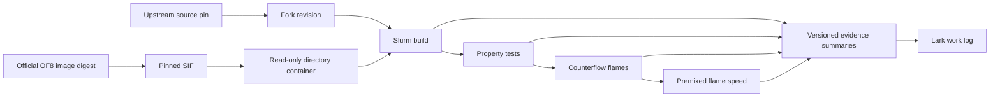
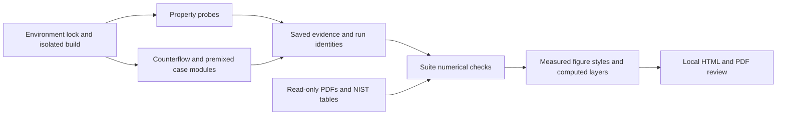

# Replication boundaries

`environment/` owns recipes, the image lock, contained execution, and job submission.
`docs/` owns the scientific plan, writing rules, and reviewed result summaries.
`development/` owns the single `develop/reacting` integration line and isolated
draft experiments. Its named solver depends on the pinned OF8/library build;
benchmark runners depend on that solver or the unchanged upstream executable.
`development/counterflow` prepares separate tutorial and paper-informed mesh
variants through the existing author/paper generators. It depends on their input
manifests and runtime density finalization; it does not modify solver numerics.
`validation/` owns case generation, property probes, and scientific comparisons;
it uses contained execution from `environment/` and a completed isolated build.
`validation/properties` owns library probes and NIST comparisons; its optional
plotting step uses a separate local matplotlib environment. `validation/flames`
uses the same property probe for inlet densities before setting velocity constraints.
`validation/figures` consumes the property and pilot artifacts plus supplied PDFs
to create a local figure atlas. It uses PyMuPDF/reportlab for extraction/reporting
and the same matplotlib environment for scientific plots; it submits no jobs.
Future case modules own their inputs, reference data provenance, comparisons, and README.

`validation/profiling` depends on a qualified build and stopped flame checkpoints.
It uses the environment runner to build a separately named, timer-instrumented
solver and replay copies of cases. It produces per-rank section timings; production
solver binaries, source builds and original case directories remain unchanged.

`validation/flames/author-counterflow` owns the original OF6 tutorial input port
to the qualified OF8 solver, including one-step-to-GRI30 field transfer. It uses
the environment runner and shared counterflow budget ledger. Its inputs supersede
the reconstructed campaign for the owner-selected baseline as of 2026-10-17.
The solver remains upstream code unless a separate source change is recorded.

`validation/flames/adaptive` copies stopped decomposed flame checkpoints and changes
time/output controls for bounded adaptive continuations. It depends on the qualified
build and environment runner, and provides hashes, smoke checks and field-change
diagnostics to later figure/convergence assessment. It does not modify solver physics.

`validation/flames/paper-campaign` extends that author-input port to the remaining
counterflow conditions and uses the existing premixed generator for the 11-point
Figure 12 sweep and selected sensitivity cases. It depends on the author transfer,
flame field checks, property probe and environment runner, and shares the bounded
reservation ledger. DeepFlame is inspected as a case reference, not a dependency.

The project workspace owns `images`, `releases`, `builds`, `jobs`, `logs`, `cache`,
`tmp`, `home`, and `results`. Each job has its own temporary and home directories.
Source releases are immutable inputs. Compilation uses a separate build copy.
An image hash identifies bytes; a preflight establishes site compatibility.

The flame module's `campaign.py` validates explicit development configurations;
`submit_campaign.sh` reserves worst-case allocated core-hours in a project-local
ledger before submission. The existing validation runner handles decomposition,
contained single-node MPI, reconstruction and final field checks. It does not
infer convergence from a successful run. Figure rendering consumes reconstructed
case fields through an explicit case manifest, separately from job submission.

`development/counterflow` owns paper-setting reconstruction and bounded refinement
qualification. It depends on author/paper case preparation, the runtime density
probe, OF8 mapFields and adaptive field checks. Private donor copies are read
from pinned coarse checkpoints; original jobs remain unchanged. Its output is
a fine-grid qualification, followed separately by developed-flow assessment.

The counterflow replay path depends on a prior fine-grid job's checked mapped
initial fields and executable. It copies those immutable inputs, records hashes
and changes checkpoint controls; it does not depend on a completed reacting run.

The counterflow steady continuation depends on a successful replay checkpoint,
its verified solver executable and adaptive field parsing. Its scheduled watcher
compares physical-time field changes and mass flux, saves convergence evidence,
and requests a checkpointed stop on a candidate or wall-time boundary. It does
not submit additional batches or equate a physical time limit with convergence.
# Repeatable comparison analysis

`suite/` joins existing modules through explicit evidence manifests. It depends on
property comparison, the OpenFOAM field reader, PDF curve extractors and the pinned
analysis environment. It has no scheduler or network dependency. Source PDFs and
bulk results remain private inputs outside Git. The environment and solver do not
depend on the analysis suite.

`development/premixed-inlet` is included from draft revision `b54a8bf` for one
reviewable source checkout. It depends on the existing flame generators and
runtime property probe; seed generation additionally uses pinned Cantera.
This assembly does not promote the numerical draft into `develop/reacting`.
