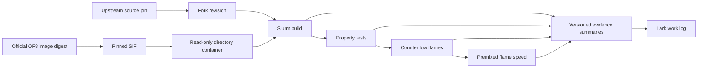

# Replication boundaries

`environment/` owns recipes, the image lock, contained execution, and job submission.
`docs/` owns the scientific plan, writing rules, and reviewed result summaries.
`validation/` owns case generation, property probes, and scientific comparisons;
it uses contained execution from `environment/` and a completed isolated build.
`validation/properties` owns library probes and NIST comparisons; its optional
plotting step uses a separate local matplotlib environment. `validation/flames`
uses the same property probe for inlet densities before setting velocity constraints.
`validation/figures` consumes the property and pilot artifacts plus supplied PDFs
to create a local figure atlas. It uses PyMuPDF/reportlab for extraction/reporting
and the same matplotlib environment for scientific plots; it submits no jobs.
Future case modules own their inputs, reference data provenance, comparisons, and README.
The solver remains upstream code unless a separate source change is recorded.

The project workspace owns `images`, `releases`, `builds`, `jobs`, `logs`, `cache`,
`tmp`, `home`, and `results`. Each job has its own temporary and home directories.
Source releases are immutable inputs. Compilation uses a separate build copy.
An image hash identifies bytes; a preflight establishes site compatibility.
