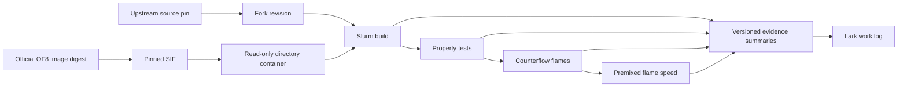

# Replication boundaries

`development/flame-tracking` uses the premixed-paper generator, ideal-baseline
donors and saved Cantera anchors to add read-only runtime OH/temperature tracking.
It reuses the environment runner and adaptive field reader for isolated build,
qualification and continuations. The species-solve source remains a separate
measure. It does not depend on Cantera at CFD runtime or alter the library.

`development/premixed-sensitivity` consumes the qualified spatial diagnostic
executable and identical products checkpoints. The validation runner dispatches
three isolated fixed-step segments. It supplies time-step and restart comparisons
to analysis without changing solver source or the active donor. The module keeps
temporal, marker, and source-stage agreement as separate acceptance checks.
Its saved-field qualification reuses the adaptive field reader for finite fields,
species normalization and heat release. Completion checks distinguish the solver
endpoint from inherited checkpoint output phases.

`development/premixed-paper` depends on the named baseline solver, flame input
generator, property probe, field reader and contained environment. It creates
central-ignition two-front cases and an isolated diagnostic solver, then supplies
stage-labelled in-situ Eq.(40) histories to plotting. It changes no library
physics. The instrumented solver must match diagnostics-off fields before use.
Its optional central products initialization consumes a versioned ideal-gas HP
seed from the earlier premixed-inlet module, with the original generator commit
and NASA7 hash recorded. This is a data dependency; Cantera is not required in
the solver runtime. Both initialization variants use the same diagnostic runner.
`development/heat-release` loads a read-only observer into these running solvers.
It depends on the qualified chemistry ABI and OF8 function-object interface,
and supplies signed source histories and fields to comparison analysis. Its
on/off replay must pass before any live controlDict attachment.
The premixed draft solver now owns a registered `Qdot` energy-source field;
heat-release qualification depends on its generator and compares the new binary
against the previous executable plus the qualified observer. Existing running
jobs retain their executable and load only the observer.
`development/premixed-spatial` depends on the premixed generator, qualified native
solver/library and immutable donor checkpoints. Its isolated replay exports local
source/diffusion/gradient fields to spatial analysis; it never replaces a live
binary. Paper-Fick and deployed corrected diffusion remain distinct outputs.

`development/ideal-baseline` depends on the premixed-paper setup, the qualified
spatial diagnostic binary, the ideal runtime library family and environment
runner. Its separate Cantera adapter reads author NASA7/reaction inputs and
supplies equilibrium seeds and independent steady flame profiles. Cantera is
not a CFD runtime dependency. Comparison plotting consumes both result sets
and a locally held Liang figure crop; it does not submit work.
Its running-case assessment reuses the premixed-sensitivity CSV reader and
kinematic tracking routines on local snapshots. It reports diagnostic gaps
without changing running jobs or promoting transient speeds to accepted data.

`environment/` owns recipes, the image lock, contained execution, and job submission.
`development/liang-panel-a` consumes the ideal-baseline Cantera profiles and
local Liang PDF. It adds ideal-gas operating points and preserves the source
panel's size and graphics in a calibrated overlay. Cases 2–5 remain paper
references. This module has no solver, scheduler or real-gas Cantera dependency.
`docs/` owns the scientific plan, writing rules, and reviewed result summaries.
`development/` owns the single `develop/reacting` integration line and isolated
draft experiments. Its named solver depends on the pinned OF8/library build;
benchmark runners depend on that solver or the unchanged upstream executable.
`validation/` owns case generation, property probes, and scientific comparisons;
it uses contained execution from `environment/` and a completed isolated build.
`validation/properties` owns library probes and NIST comparisons; its optional
plotting step uses a separate local matplotlib environment. `validation/flames`
uses the same property probe for inlet densities before setting velocity constraints.
`validation/figures` consumes the property and pilot artifacts plus supplied PDFs
to create a local figure atlas. It uses PyMuPDF/reportlab for extraction/reporting
and the same matplotlib environment for scientific plots; it submits no jobs.
Future case modules own their inputs, reference data provenance, comparisons, and README.

`validation/profiling` depends on a qualified build and stopped flame checkpoints.
It uses the environment runner to build a separately named, timer-instrumented
solver and replay copies of cases. It produces per-rank section timings; production
solver binaries, source builds and original case directories remain unchanged.

`validation/flames/author-counterflow` owns the original OF6 tutorial input port
to the qualified OF8 solver, including one-step-to-GRI30 field transfer. It uses
the environment runner and shared counterflow budget ledger. Its inputs supersede
the reconstructed campaign for the owner-selected baseline as of 2026-10-17.
The solver remains upstream code unless a separate source change is recorded.

`validation/flames/adaptive` copies stopped decomposed flame checkpoints and changes
time/output controls for bounded adaptive continuations. It depends on the qualified
build and environment runner, and provides hashes, smoke checks and field-change
diagnostics to later figure/convergence assessment. It does not modify solver physics.

`validation/flames/paper-campaign` extends that author-input port to the remaining
counterflow conditions and uses the existing premixed generator for the 11-point
Figure 12 sweep and selected sensitivity cases. It depends on the author transfer,
flame field checks, property probe and environment runner, and shares the bounded
reservation ledger. DeepFlame is inspected as a case reference, not a dependency.

The project workspace owns `images`, `releases`, `builds`, `jobs`, `logs`, `cache`,
`tmp`, `home`, and `results`. Each job has its own temporary and home directories.
Source releases are immutable inputs. Compilation uses a separate build copy.
An image hash identifies bytes; a preflight establishes site compatibility.

The flame module's `campaign.py` validates explicit development configurations;
`submit_campaign.sh` reserves worst-case allocated core-hours in a project-local
ledger before submission. The existing validation runner handles decomposition,
contained single-node MPI, reconstruction and final field checks. It does not
infer convergence from a successful run. Figure rendering consumes reconstructed
case fields through an explicit case manifest, separately from job submission.
