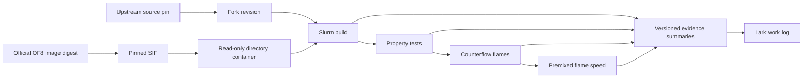

# Replication boundaries

`environment/` owns recipes, the image lock, contained execution, and job submission.
`docs/` owns the scientific plan, writing rules, and reviewed result summaries.
`validation/` owns case generation, property probes, and scientific comparisons;
it uses contained execution from `environment/` and a completed isolated build.
`validation/properties` owns library probes and NIST comparisons; its optional
plotting step uses a separate local matplotlib environment. `validation/flames`
uses the same property probe for inlet densities before setting velocity constraints.
`validation/figures` consumes the property and pilot artifacts plus supplied PDFs
to create a local figure atlas. It uses PyMuPDF/reportlab for extraction/reporting
and the same matplotlib environment for scientific plots; it submits no jobs.
Future case modules own their inputs, reference data provenance, comparisons, and README.

`validation/profiling` depends on a qualified build and stopped flame checkpoints.
It uses the environment runner to build a separately named, timer-instrumented
solver and replay copies of cases. It produces per-rank section timings; production
solver binaries, source builds and original case directories remain unchanged.

`validation/flames/author-counterflow` owns the original OF6 tutorial input port
to the qualified OF8 solver, including one-step-to-GRI30 field transfer. It uses
the environment runner and shared counterflow budget ledger. Its inputs supersede
the reconstructed campaign for the owner-selected baseline as of 2026-10-17.
The solver remains upstream code unless a separate source change is recorded.

`validation/flames/paper-campaign` extends that author-input port to the remaining
counterflow conditions and uses the existing premixed generator for the 11-point
Figure 12 sweep and selected sensitivity cases. It depends on the author transfer,
flame field checks, property probe and environment runner, and shares the bounded
reservation ledger. DeepFlame is inspected as a case reference, not a dependency.

The project workspace owns `images`, `releases`, `builds`, `jobs`, `logs`, `cache`,
`tmp`, `home`, and `results`. Each job has its own temporary and home directories.
Source releases are immutable inputs. Compilation uses a separate build copy.
An image hash identifies bytes; a preflight establishes site compatibility.

The flame module's `campaign.py` validates explicit development configurations;
`submit_campaign.sh` reserves worst-case allocated core-hours in a project-local
ledger before submission. The existing validation runner handles decomposition,
contained single-node MPI, reconstruction and final field checks. It does not
infer convergence from a successful run. Figure rendering consumes reconstructed
case fields through an explicit case manifest, separately from job submission.
