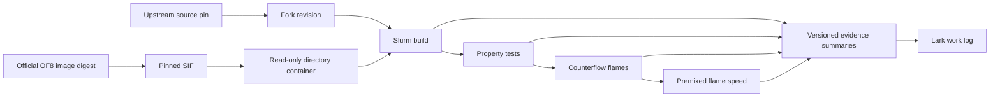

# Replication boundaries

`development/liang-hydrogen` consumes the author Burke 2012 mechanism and
qualified species parameters, reusing `cantera-liang` SRK, transport,
pressure-chemistry and total-enthalpy adapters. It supplies Figures 3–7 with
steady hydrogen flame and transport profiles; Figure 2 remains the independent
`liang-properties` critical audit. Downloaded mechanism files stay outside Git.
Its bounded Slurm jobs have no production CFD or transient-restart dependency.
Its read-only collector retrieves selected small job artifacts. The independent
NumPy/PyMuPDF renderer overlays those profiles on the locally supplied paper
panels and exports PNG/PDF evidence; it never changes models or submits jobs.
The energy diagnostics reuse the previously qualified SRK C4 alpha continuation
and can explicitly subdivide every initial-grid interval for convergence checks.

`validation/diffusion` consumes committed Liang flame comparisons, primary-source
diffusion fixtures, author mechanism inputs and the pinned Cantera 3.2 SDK. Its
prescribed-state C++ probe uses the actual `cantera-liang/StagedTransport.h`;
independent Python calculations verify its correlation and compare dilute
transport with measurements. It supplies the Case 5 investigation with property
gates, without changing model parameters or solving flames. Production solvers
have no dependency on this module. Its optional NumPy/Matplotlib renderer consumes
the gate artifacts and supplies a property-comparison PNG/PDF to the report.
The extended property renderer also uses PyMuPDF to preserve the earlier PDF
page while adding light-species and high-pressure self-diffusion comparisons.
These measured and evaluated-reference checks change no flame-model inputs.

`development/cantera-wave` consumes a screened ideal Cantera profile and the
`fresh-start` case generator. Its Python generator produces mirrored original-zero
fields without a Cantera runtime. The native runner depends on
`temperature-inversion`, a qualified library, OF8 and Slurm. Its optional
Cantera transport mode adds the existing `cantera-cfd` instrumenter/configurator
and qualified `cantera-bridge` runtime. Default native execution has no Cantera
runtime dependency. It does not supply a transient restart.

`development/temperature-inversion` consumes an isolated full native library
build and generates original-zero ideal flames through `fresh-start`.
It uses `flame-tracking`, `premixed-paper`, the `cantera-cfd` static partitioner
and the adaptive field reader. Its solver has no Cantera runtime dependency.
Explicit CPU assignments and global-field parity qualify 32-rank execution.
Its front and heat-release histories feed the comparison gallery.

`validation/profiling/affinity.py` reads the current Slurm allocation's solver
processes and can assign distinct CPUs inside their existing affinity union.
It depends on Linux/Python process APIs only and changes no solver source, field,
time history or scheduler allocation. Its JSON receipts feed performance reports.

`development/cantera-cfd` depends on `cantera-bridge`, `flame-tracking` and
`fresh-start`. It builds an isolated ideal-gas transport experiment using
Cantera conductivity/diffusion and refreshed native species enthalpies.
It consumes original-zero inputs; it does not replace production thermodynamics
or chemistry. Its bridge binary must pass separate ABI/property qualification.
Its optional `bands32` execution profile uses the shared adaptive field reader
to check the original slab, then writes a manual cell-to-rank assignment.
`fresh-start` verifies all 32 declared zero-time partitions. No model coefficients
or physical mesh are changed by this execution profile.

`development/cantera-bridge` depends on the pinned Cantera3.2 SDK and
`development/cantera-liang` adapters. It exposes state properties and net sources
through a C ABI, with no Cantera/OpenFOAM C++ objects crossing the boundary.
Its independent ABI client consumes saved FreeFlame profiles for parity checks.
No production CFD solver depends on this draft yet.

`development/cantera-bridge` also exposes an experimental closed constant-pressure
chemistry step through Cantera ReactorNet/CVODES. It depends on the same SDK and
model adapters. Frozen Python reactor references qualify the ideal closure before
coupling. `cantera-cfd` has a separately configured adiabatic-CP experiment that
converts integrated mass-fraction changes into species and sensible-energy
sources. Transport-only mode remains the default; no nonideal CFD is enabled.

`development/cantera-liang` registers SRK thermo and staged transport with the
pinned Cantera C++ SDK. It consumes ideal-baseline mechanisms/profiles and the
liang-properties Ely–Hanley kernel. Its independent steady flames feed the
Liang comparison report; production OpenFOAM code has no dependency on it.

`development/fresh-start` consumes ideal-baseline initial-state generation,
premixed-paper boundary finalization and flame-tracking anchors/checks. It reuses
qualified native/energy binaries with unchanged libraries and supplies time-0
histories to solver-comparison. It has no dependency on donor checkpoints.

`development/solver-comparison/sampleHistory.C` consumes frozen stock/DeepFlame
line profiles through the shared `flame-tracking/trackingCore.H`. Its CSVs and
native in-situ tracking CSVs feed `plot_history.py` (NumPy/Matplotlib), which owns
offline time-history PNG/PDF/CSV exports and provenance for the Lark comparison.
This analysis path has no scheduler or solver mutation dependency.

`development/flame-tracking` uses the premixed-paper generator, ideal-baseline
donors and saved Cantera anchors to add read-only runtime OH/temperature tracking.
It reuses the environment runner and adaptive field reader for isolated build,
qualification and continuations. The species-solve source remains a separate
measure. It does not depend on Cantera at CFD runtime or alter the library.

`development/premixed-sensitivity` consumes the qualified spatial diagnostic
executable and identical products checkpoints. The validation runner dispatches
three isolated fixed-step segments. It supplies time-step and restart comparisons
to analysis without changing solver source or the active donor. The module keeps
temporal, marker, and source-stage agreement as separate acceptance checks.
Its saved-field qualification reuses the adaptive field reader for finite fields,
species normalization and heat release. Completion checks distinguish the solver
endpoint from inherited checkpoint output phases.

`development/premixed-paper` depends on the named baseline solver, flame input
generator, property probe, field reader and contained environment. It creates
central-ignition two-front cases and an isolated diagnostic solver, then supplies
stage-labelled in-situ Eq.(40) histories to plotting. It changes no library
physics. The instrumented solver must match diagnostics-off fields before use.
Its optional central products initialization consumes a versioned ideal-gas HP
seed from the earlier premixed-inlet module, with the original generator commit
and NASA7 hash recorded. This is a data dependency; Cantera is not required in
the solver runtime. Both initialization variants use the same diagnostic runner.
`development/heat-release` loads a read-only observer into these running solvers.
It depends on the qualified chemistry ABI and OF8 function-object interface,
and supplies signed source histories and fields to comparison analysis. Its
on/off replay must pass before any live controlDict attachment.
The premixed draft solver now owns a registered `Qdot` energy-source field;
heat-release qualification depends on its generator and compares the new binary
against the previous executable plus the qualified observer. Existing running
jobs retain their executable and load only the observer.
`development/premixed-spatial` depends on the premixed generator, qualified native
solver/library and immutable donor checkpoints. Its isolated replay exports local
source/diffusion/gradient fields to spatial analysis; it never replaces a live
binary. Paper-Fick and deployed corrected diffusion remain distinct outputs.

`development/ideal-baseline` depends on the premixed-paper setup, the qualified
spatial diagnostic binary, the ideal runtime library family and environment
runner. Its separate Cantera adapter reads author NASA7/reaction inputs and
supplies equilibrium seeds and independent steady flame profiles. Cantera is
not a CFD runtime dependency. Comparison plotting consumes both result sets
and a locally held Liang figure crop; it does not submit work.
Its running-case assessment reuses the premixed-sensitivity CSV reader and
kinematic tracking routines on local snapshots. It reports diagnostic gaps
without changing running jobs or promoting transient speeds to accepted data.

`development/liang-properties` consumes the qualified SRK library and author
species data for density/critical-point probes, and owns an independent
Ely–Hanley conductivity kernel. It supplies property CSV and original-scale
Liang Figure 1/2 comparisons. It has no Cantera flame dependency and does not
change production solver physics. Staged reacting closures depend on these
property checks before promotion.
Its offline critical audit uses NumPy for independent pressure-derivative solves
and PyMuPDF for calibrated source-curve extraction. It reads the native probe CSV
and species dictionary; it never supplies fitted coefficients to a reacting run.

`environment/` owns recipes, the image lock, contained execution, and job submission.
`development/liang-panel-a` consumes the ideal-baseline Cantera profiles and
local Liang PDF. It adds ideal-gas operating points and preserves the source
panel's size and graphics in a calibrated overlay. Cases 2–5 remain paper
references. This module has no solver, scheduler or real-gas Cantera dependency.
`docs/` owns the scientific plan, writing rules, and reviewed result summaries.
`development/` owns the single `develop/reacting` integration line and isolated
draft experiments. Its named solver depends on the pinned OF8/library build;
benchmark runners depend on that solver or the unchanged upstream executable.
`validation/` owns case generation, property probes, and scientific comparisons;
it uses contained execution from `environment/` and a completed isolated build.
`validation/properties` owns library probes and NIST comparisons; its optional
plotting step uses a separate local matplotlib environment. `validation/flames`
uses the same property probe for inlet densities before setting velocity constraints.
`validation/figures` consumes the property and pilot artifacts plus supplied PDFs
to create a local figure atlas. It uses PyMuPDF/reportlab for extraction/reporting
and the same matplotlib environment for scientific plots; it submits no jobs.
Future case modules own their inputs, reference data provenance, comparisons, and README.

`validation/profiling` depends on a qualified build and stopped flame checkpoints.
It uses the environment runner to build a separately named, timer-instrumented
solver and replay copies of cases. It produces per-rank section timings; production
solver binaries, source builds and original case directories remain unchanged.

`validation/flames/author-counterflow` owns the original OF6 tutorial input port
to the qualified OF8 solver, including one-step-to-GRI30 field transfer. It uses
the environment runner and shared counterflow budget ledger. Its inputs supersede
the reconstructed campaign for the owner-selected baseline as of 2026-10-17.
The solver remains upstream code unless a separate source change is recorded.

`validation/flames/adaptive` copies stopped decomposed flame checkpoints and changes
time/output controls for bounded adaptive continuations. It depends on the qualified
build and environment runner, and provides hashes, smoke checks and field-change
diagnostics to later figure/convergence assessment. It does not modify solver physics.

`validation/flames/paper-campaign` extends that author-input port to the remaining
counterflow conditions and uses the existing premixed generator for the 11-point
Figure 12 sweep and selected sensitivity cases. It depends on the author transfer,
flame field checks, property probe and environment runner, and shares the bounded
reservation ledger. DeepFlame is inspected as a case reference, not a dependency.

The project workspace owns `images`, `releases`, `builds`, `jobs`, `logs`, `cache`,
`tmp`, `home`, and `results`. Each job has its own temporary and home directories.
Source releases are immutable inputs. Compilation uses a separate build copy.
An image hash identifies bytes; a preflight establishes site compatibility.

The flame module's `campaign.py` validates explicit development configurations;
`submit_campaign.sh` reserves worst-case allocated core-hours in a project-local
ledger before submission. The existing validation runner handles decomposition,
contained single-node MPI, reconstruction and final field checks. It does not
infer convergence from a successful run. Figure rendering consumes reconstructed
case fields through an explicit case manifest, separately from job submission.

`development/solver-comparison` consumes ideal-baseline seeds and Cantera profiles
for isolated stock OF8 and DeepFlame OF7 runs and native chemistry probes. It owns
its contained build/job wrappers and read-only sampling. Its outputs feed the
flame diagnosis; it does not replace the production solver or its live cases.
Its offline profile adapter depends on `development/flame-tracking/trackingCore.H`
for the same marker and gas-relative speed definitions. Its read-only source audit
compares the Linux build copy with the pinned Git archive, including path casing.

`development/cantera-liang` owns staged steady-flame diagnostics against Liang.
It depends on the pinned Cantera SDK, `ideal-baseline` inputs and the shared
`liang-properties` conductivity kernel. Its optional pressure-chemistry source
adapter owns a separate ideal Cantera phase; the SRK flow phase remains separate.
Frozen-state and energy-flux probes qualify these diagnostic options before
figure comparisons. Production OpenFOAM solvers do not depend on this module.
